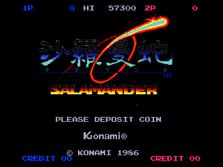
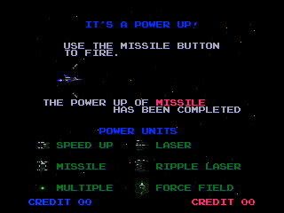
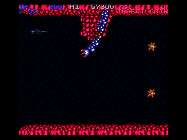
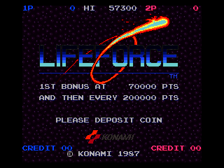
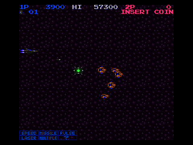
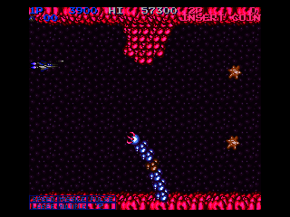
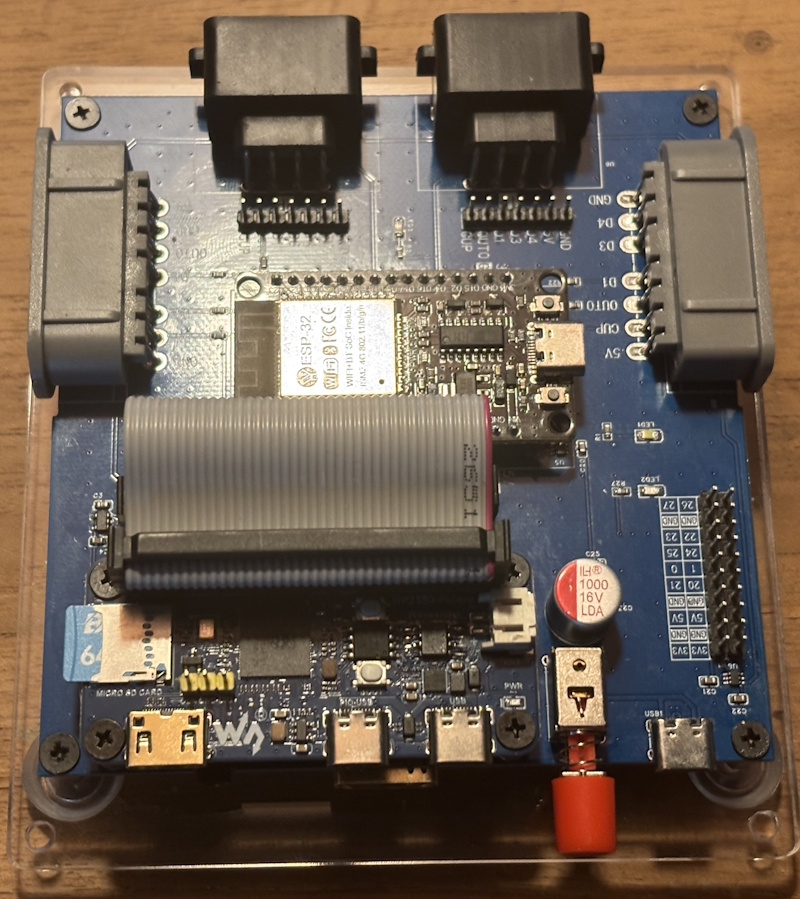
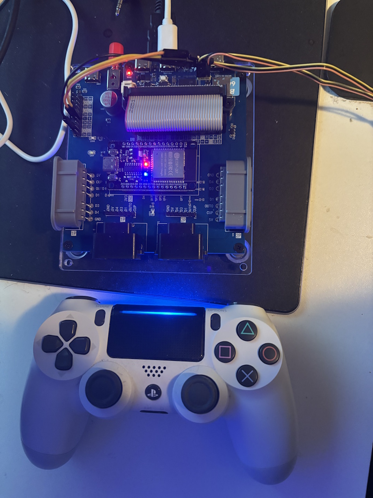
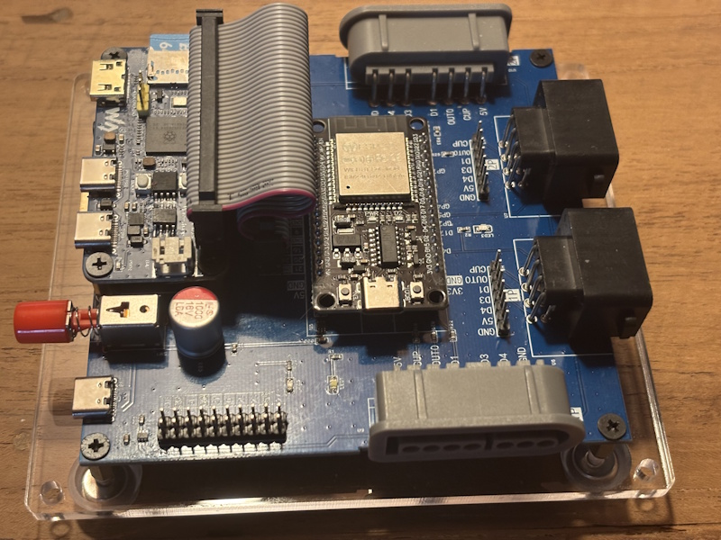
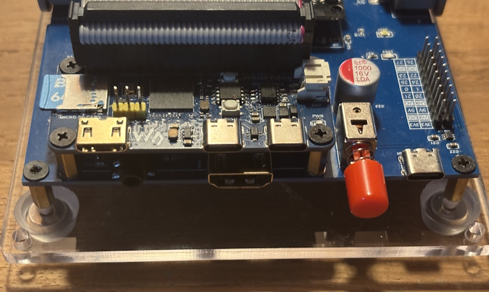

# pico-salamander

**pico-salamander** is an emulator of the arcade games **Salamander** and **Lifeforce** (Konami, 1986) for RP2350-based microcontroller boards, with video and audio over HDMI. It emulates the original board (Konami GX587): the 68000 main CPU, its two scrolling layers of characters, its zoomable sprites and its palette, and the sound board with its Z80, the Yamaha YM2151 FM chip, the Konami K007232 PCM chip and the Sanyo VLM5030 speech chip. The emulation is based on the nemesis driver of [MAME](https://www.mamedev.org/), the 68000 core [Musashi](https://github.com/kstenerud/Musashi) and MAME's Z80, YM2151, K007232 and VLM5030 emulations.

It runs on the [Adafruit Fruit Jam](https://www.adafruit.com/product/6200), the [Pimoroni Pico Plus 2](https://shop.pimoroni.com/products/pimoroni-pico-plus-2?variant=42092668289107) or [Raspberry Pi Pico 2](https://www.adafruit.com/product/6006) with the Adafruit DVI breakout, the [Murmulator M2](https://murmulator.ru), the [Adafruit Feather RP2350 with HSTX Port](https://www.adafruit.com/product/6130), the [Olimex RP2040-PICO-PC](https://www.olimex.com/Products/MicroPython/PICO/RP2040-PICO-PC/) with a Pimoroni Pico Plus 2 or Raspberry Pi Pico 2, the [Pico Computer 3](https://github.com/UKTailwind/Pico-Computer-3), and the [PCB for the Waveshare RP2350-PiZero](https://github.com/PicoPlus-devel/pico-infonesPlus#pcb-with-waveshare-rp2350-pizero); see [Supported hardware](#supported-hardware).

It uses the same menu, display, audio and controller framework as this family of emulators:

- NES: [pico-infonesPlus](https://github.com/PicoPlus-devel/pico-infonesPlus)
- Super Nintendo: [pico-snesPlus](https://github.com/PicoPlus-devel/pico-snesPlus)
- Sega Master System / Game Gear: [pico-smsplus](https://github.com/PicoPlus-devel/pico-smsplus)
- Game Boy / Game Boy Color: [pico-peanutGB](https://github.com/PicoPlus-devel/pico-peanutGB)
- Sega Mega Drive / Genesis: [pico-genesisPlus](https://github.com/PicoPlus-devel/pico-genesisPlus)
- OutRun: [pico-outrun](https://github.com/PicoPlus-devel/pico-outrun)
- 1943 and 1943 Kai: [pico-1943](https://github.com/PicoPlus-devel/pico-1943)
- Phoenix: [pico-phoenix](https://github.com/PicoPlus-devel/pico-phoenix)
- Moon Cresta: [pico-mooncresta](https://github.com/PicoPlus-devel/pico-mooncresta)
- Pac-Man, Galaga, 1942 and other games: [pico-galagino](https://github.com/PicoPlus-devel/pico-galagino)

**The ROM sets are not included and must be supplied by the user.** They are copyright Konami and are not distributed with this project.

**updateAll can download the ROM sets.** updateAll, the ROM set installer included in every release as `updateAll.exe` (Windows; a Python version for Linux and macOS is available in pico-bootLoader), downloads the two sets from a third-party database when they are not at hand and installs them on the SD card. The user remains responsible for holding the rights to the sets. See [Game data](#game-data).

The emulator can also be started from [pico-bootLoader](https://github.com/PicoPlus-devel/pico-bootLoader), where it appears in the Arcade category.

***

## Getting started

1. **Flash the emulator.** Download the `.uf2` for your board from the [Releases](https://github.com/PicoPlus-devel/pico-salamander/releases) page; the table under [Supported hardware](#supported-hardware) gives the file name for each board. Hold BOOTSEL, connect the board over USB, and copy the `.uf2` onto the `RP2350` drive that appears.
2. **Prepare the SD card.** Format a microSD card as FAT32 (recommended) or exFAT. The board creates the folders `/roms/arcade/SALAMAND` and `/roms/arcade/LIFEFRCE` the first time it starts with the card inserted, and shows which files it is missing.
3. **Copy the ROM sets.** Copy MAME's `salamand.zip` into `/roms/arcade/SALAMAND` and `lifefrce.zip` into `/roms/arcade/LIFEFRCE`, with a card reader or through [USB drive mode](#usb-drive-mode) from the screen that reports the missing files. One of the two games is enough. The ROM sets are not part of this project, and holding the rights to them is the user's responsibility; [Game data](#game-data) describes which versions are accepted and how the files are recognised, and how `updateAll`, included in every release, installs the sets from a Windows computer.
4. **Play.** Insert the card and power on the board. With both sets on the card, a menu chooses the game; with one, that game starts. Press **SELECT** to insert a coin and **START** to play.

***

## Screenshots

The games as the emulator draws them. The pictures were captured with the [host test harness](#host-test-harness), which runs the same emulation as the firmware; on the board the 256 x 224 picture is centred in the 320 x 240 display in the same way. `tools/screenshots.sh` makes them again from your own ROM sets.

<table>
  <tr>
    <td></td>
    <td></td>
    <td></td>
  </tr>
  <tr>
    <td align="center">Salamander: title screen</td>
    <td align="center">Salamander: the tutorial of the attract mode</td>
    <td align="center">Salamander: the first stage</td>
  </tr>
  <tr>
    <td></td>
    <td></td>
    <td></td>
  </tr>
  <tr>
    <td align="center">Lifeforce (Japan): title screen</td>
    <td align="center">Lifeforce: the first stage, with the power meter</td>
    <td align="center">Lifeforce: the organic walls of the first stage</td>
  </tr>
</table>

***

## Status and limitations

> [!NOTE]
> This is work in progress. Both games run from attract mode through the stages with sound, at the speed of the original, but the emulation is not finished and is still being compared with MAME.

Worth knowing before you start:

- **No save states, and high scores are not kept.** A high score survives until the board is reset or powered off.
- **The DIP switches start at MAME's defaults**: 1 coin for 1 credit, 3 lives, normal difficulty, demo sounds on, upright cabinet. They can be changed in the settings menu; see [DIP switches](#dip-switches). The flip screen and cabinet switches are not offered, because the flipped picture of a cocktail cabinet is not emulated.
- Development and testing take place on the Adafruit Fruit Jam. The other supported boards are built by the release workflow but need more testing. Running without PSRAM has been tested on a plain Raspberry Pi Pico 2 (HW_CONFIG 2) and on the Fruit Jam with the *Disable PSRAM* setting.

***

## Game data

Two MAME sets are supported, each in its own folder on the SD card:

| Game | MAME set | SD card folder |
| --- | --- | --- |
| Salamander | `salamand`, or one of its clones `salamandj`, `salamandt` | `/roms/arcade/SALAMAND` |
| Lifeforce | `lifefrce` or `lifefrcej` | `/roms/arcade/LIFEFRCE` |

The versions of Salamander differ in the two program ROMs of the main CPU (and, for the Tecfri licence, in the sound ROM and the way the data is split over ROMs). The first complete one is used, in this order: `salamand` (version D), `salamandj` (version J), `salamandt` (Tecfri licence). Lifeforce is tried as `lifefrce` (US) first, then `lifefrcej` (Japan), the version with the power meter and three buttons. A set takes about 690 KB.

Copy the sets to their folders in either form:

- **The zip as it is**: `salamand.zip` and `lifefrce.zip`. Merged, split and non-merged sets all work. In MAME's merged `salamand.zip` the clones are in subfolders of the archive; they are found there. In MAME, Lifeforce is a clone of Salamander: a split `lifefrce.zip` holds only the files that differ and needs `salamand.zip` in the same folder for the rest, and MAME's merged `salamand.zip` holds Lifeforce as well, so it can be copied to both folders.
- **The files, unzipped.** Subfolders named after the set or its clones (`salamand`, `salamandj`, ...), which unzipping commonly produces, are searched as well.

Files are recognised by their size and CRC32, so their names do not matter, and a corrupt or different file is never loaded. The board creates the two folders on first start.

**updateAll installs the sets.** `updateAll.exe`, a program for Windows 10 and 11, is included in every release of pico-salamander, among the files at the end of the release page. It runs on a computer with the SD card inserted: it takes `salamand.zip` and `lifefrce.zip` from a folder of your choice, or downloads them when they are not there, and writes the sets, unzipped, into `/roms/arcade/SALAMAND` and `/roms/arcade/LIFEFRCE`. It installs Salamander version D, `salamand`, and Lifeforce US, `lifefrce`, both from a merged `salamand.zip`, or Lifeforce from `lifefrce.zip` together with a split `salamand.zip`. It is a single file and needs no installation. The program is not signed, so Windows may show "Windows protected your PC" the first time it is started; select **More info**, then **Run anyway**.

1. Start `updateAll.exe`. It selects a removable drive by itself; under **SD card**, check that it is the card, or choose another.
2. Under **Zip folder**, choose the folder with the MAME zips you already have, if any.
3. Untick the sets that are not wanted. updateAll also installs the sets of other applications of this family, such as pico-galagino and pico-outrun; pico-salamander needs only the sets **Salamander** and **Lifeforce**, or one of them. The **Status** column shows which sets are already complete on the card.
4. Select **Install**.

By default, zips that are not in the zip folder are downloaded from [ArcadeROMsDB_MiSTer](https://github.com/zakk4223/ArcadeROMsDB_MiSTer), a third-party database that is not part of this project. The user is responsible for holding the rights to the ROM sets, whether they are supplied as zips or downloaded. To use only your own zips, untick **Download missing files**.

updateAll is maintained in [pico-bootLoader](https://github.com/PicoPlus-devel/pico-bootLoader), whose SD-card archive carries it as well. The same installer is also available there as a Python script, `updateAll.py`, for Linux and macOS, and as a PowerShell script, `updateAll.ps1`. The [updateAll README](https://github.com/PicoPlus-devel/pico-bootLoader/blob/main/updateAll/README.md) describes all three and their options.

When both games are on the card, a menu at start-up chooses one; it starts the game played last after 10 seconds without input. *Quit game* in the settings menu returns to it.

When no set is complete, the board shows a screen that names the missing files. **SELECT + START** opens the settings menu from that screen; its *USB drive mode* shows the SD card on a computer, so the ROM sets can be copied to it without removing the card. After leaving the menu, the board restarts and looks for the sets again.

**Boards without PSRAM.** The game's data does not fit in the internal SRAM of the RP2350. On boards with PSRAM (for example the Adafruit Fruit Jam) it is built there each time a game starts. On boards without PSRAM, it is copied into the flash memory of the board, after the program, the first time a game is started: the board shows a notice, restarts, copies the set with a dark screen and a blinking LED, and starts the game. This takes a few seconds. Later starts use the copy and do not need the SD card. A copy takes 704 KB of flash. When the flash has room for both games, both are kept; otherwise starting the other game replaces the copy. An application started from pico-bootLoader can overwrite the copy, which is then made again the next time the game starts.

***

## Supported hardware

An RP2350 board is required, and video must run over HSTX. PSRAM is optional; see [Boards without PSRAM](#game-data). Only the seven hardware configurations below are supported; the build stops with an error for RP2040 boards and for the configurations that use the bit-banged PicoDVI driver.

| HW_CONFIG | Hardware | Binary |
| --- | --- | --- |
| 2 | [Pimoroni Pico Plus 2](https://shop.pimoroni.com/products/pimoroni-pico-plus-2?variant=42092668289107) or [Raspberry Pi Pico 2](https://www.adafruit.com/product/6006) with the [Adafruit DVI Breakout](https://www.adafruit.com/product/4984) and a microSD breakout, on a breadboard or on the [PicoNES PCB](#picones-pcb) | `picoSalamander_AdafruitDVISD_pico2_arm.uf2` |
| 8 | [Adafruit Fruit Jam](https://www.adafruit.com/product/6200) (primary development and test board) | `picoSalamander_AdafruitFruitJam_arm_piousb.uf2` |
| 13 | [Murmulator M2](https://murmulator.ru) | `picoSalamander_MurmulatorM2_arm.uf2` |
| 14 | [Adafruit Feather RP2350 with HSTX Port](https://www.adafruit.com/product/6130) with TLV320DAC3100 I2S DAC and microSD breakout | `picoSalamander_AdafruitFeatherRP2350_TLV320DAC3100_arm_piousb.uf2` |
| 15 | [Olimex RP2040-PICO-PC](https://www.olimex.com/Products/MicroPython/PICO/RP2040-PICO-PC/) with a Pimoroni Pico Plus 2 or another Pico 2 compatible board | `picoSalamander_OlimexPicoPC_arm.uf2` |
| 17 | [Pico Computer 3](https://github.com/UKTailwind/Pico-Computer-3) | `picoSalamander_PicoComputer3_arm.uf2` |
| 18 | [PCB for the Waveshare RP2350-PiZero](https://github.com/PicoPlus-devel/pico-infonesPlus#pcb-with-waveshare-rp2350-pizero) | `picoSalamander_WaveShareRP2350PiZeroLiuPCB_arm_piousb.uf2` |

Notes per configuration:

- **HW_CONFIG 2**: a plain Raspberry Pi Pico 2, which has no PSRAM, runs the game from flash. There is no binary for the Pico 2 W. The [PicoNES PCB](#picones-pcb) is the tidy version of this configuration and gives the two controller ports of a two player game. The two builds take different microSD breakouts: on a breadboard the [Adafruit Micro-SD breakout board+](https://www.adafruit.com/product/254), on the PCB the smaller [Adafruit Micro SD SPI or SDIO breakout](https://www.adafruit.com/product/4682), which is the footprint the board is laid out for.
- **HW_CONFIG 8**: no additional hardware is required apart from one or two USB game controllers. Button 2 switches the NeoPixel VU meter on and off.
- **HW_CONFIG 14**: the Feather RP2350 is sold in two variants: [with 8 MB PSRAM onboard](https://www.adafruit.com/product/6130) and [without PSRAM](https://www.adafruit.com/product/6000). The variant without PSRAM runs the game from flash, or uses a PSRAM chip when one is soldered onto the board.
- **HW_CONFIG 15**: a standard Raspberry Pi Pico 2 runs the game from flash. A board with 8 MB of PSRAM uses it, with its chip select on GPIO 8 or GPIO 47. A NES or SNES controller can be connected to the UEXT connector: clock on GPIO 5, latch on GPIO 9 and data on GPIO 20. There is only one controller port and no Wii Classic controller support. Support for this board was contributed by [DnCraptor](https://github.com/DnCraptor).
- **HW_CONFIG 17**: the Pico Computer 3 has 8 MB of PSRAM on the board. Up to two NES or SNES controllers and a Wii Classic controller connect to its I/O header H4; the pins are listed under [Pico Computer 3](https://github.com/PicoPlus-devel/pico-infonesPlus#pico-computer-3) in the pico-infonesPlus readme. The pin assignment may still change. Support for this board was contributed by [javavi](https://github.com/javavi).
- **HW_CONFIG 18**: a PCB for the [Waveshare RP2350-PiZero](https://www.waveshare.com/rp2350-pizero.htm), designed by Liu Szuping ([szuping](https://github.com/szuping)); the PCB design is not yet available. Without PSRAM the game runs from flash. PSRAM is optional and has to be soldered onto the RP2350-PiZero; a board that combines it with a non-Winbond flash chip needs the [flash_config fix](https://github.com/PicoPlus-devel/pico-infonesPlus#psram-with-a-non-winbond-flash-chip) first. Video goes through the HDMI port of the PCB, not the mini HDMI port of the RP2350-PiZero. A USB controller connects to the PIO-USB port of the RP2350-PiZero, and up to two NES or SNES controllers to the controller ports of the PCB. With an ESP32 module running [BlueRetro](https://github.com/darthcloud/blueretro) in the socket of the PCB, Bluetooth controllers are used instead of the controller ports; remove the module to use the ports. During play, some TVs and monitors lose the picture for a few seconds at a time, while others show it without interruption. This is a limitation of the RP2350-PiZero at 384 MHz, the clock the game requires; programs that run at 252 MHz are not affected. See [PCB with Waveshare RP2350-PiZero](https://github.com/PicoPlus-devel/pico-infonesPlus#pcb-with-waveshare-rp2350-pizero) in the pico-infonesPlus readme.
- **Audio** is sent over HDMI by default. Configurations 8, 13, 14, 17 and 18 also have an I2S audio output, selected with *External Audio* in the settings menu; on the Fruit Jam, plugging in headphones selects it automatically. Configuration 2 has HDMI audio only. Configuration 15 plays the sound through HDMI and the board's audio jack at the same time.

The [PCB for the Waveshare RP2350-PiZero](https://github.com/PicoPlus-devel/pico-infonesPlus#pcb-with-waveshare-rp2350-pizero) (HW_CONFIG 18), designed by Liu Szuping:

|  |  |
|:--:|:--:|
|  |  |

For wiring and assembly instructions, see the setup sections of the [pico-infonesPlus README](https://github.com/PicoPlus-devel/pico-infonesPlus#setup); for the PCB version of HW_CONFIG 2, see [PicoNES PCB](#picones-pcb) below. Flashing works the same for every board: hold BOOTSEL while connecting the board over USB, then copy the `.uf2` file onto the USB drive that appears.

***

## Overclocking

All seven configurations run at **384 MHz at 1.35 V**, as pico-outrun does. The clock is fixed: the sister projects offer an *Overclock* setting in their menus, but here the entry is not shown. The main CPU and the drawing run on the first core; the second core feeds the display and runs the sound board (the Z80 and the three sound chips) in between. When a frame takes longer than the display allows, the next picture is not drawn, so the game and its sound keep their speed.

That clock is also why the board configurations driven by the bit-banged PicoDVI driver are not supported. There the system clock is tied to the pixel clock and cannot exceed 324 MHz, and without the HSTX driver's background task the sound board would have to run on the first core as well. The build refuses those configurations, and `./bld.sh -D`, which forces the PicoDVI driver on an HSTX-capable board, is refused in the same way.

Use this software at your own risk. I am not responsible in any way for damage to your board and/or connected peripherals caused by using this software or by incorrect wiring or voltages.

***

## PicoNES PCB

The PicoNES PCB turns the HW_CONFIG 2 breadboard build into a small console. It carries the microcontroller board, the DVI and microSD breakouts and two controller ports, so two players can play with two controllers. It comes in two versions, which differ only in the controller ports: **v2.6** with NES controller ports and **v2.8** with SNES controller ports. For this emulator, fit a Pimoroni Pico Plus 2 on male headers, or a Raspberry Pi Pico 2, which runs the game from flash. The RP2040-based Raspberry Pi Pico and Pico W in the parts list of the PCB README cannot run it, and there is no binary for the Pico 2 W. Parts lists, assembly notes, the pin assignment and the 3D-printed case are described in the [PCB README](https://github.com/PicoPlus-devel/pico_shared/blob/main/PCB/README.md): [PicoNES v2.6](https://github.com/PicoPlus-devel/pico_shared/blob/main/PCB/README.md#picones-v26-nes-controller-ports) and [PicoNES v2.8](https://github.com/PicoPlus-devel/pico_shared/blob/main/PCB/README.md#picones-v28-snes-controller-ports).

| NES controller ports (v2.6) | SNES controller ports (v2.8) |
| --------------------------- | ---------------------------- |
|  |  |

The PicoNES Mini and PicoNES Micro cannot be used: they are other hardware configurations, without HSTX video. On designs v2.1 and older the microcontroller board must lie flat on the PCB, so they take a Raspberry Pi Pico 2 but not a Pimoroni Pico Plus 2. Flash `picoSalamander_AdafruitDVISD_pico2_arm.uf2`, the same file as the breadboard build, since the PCB is the same hardware configuration. Audio is carried over HDMI.

Gavin Knight ([DynaMight1124](https://github.com/DynaMight1124)) designed an NES-like case for the v2.6 PCB: [thingiverse.com/thing:6689537](https://www.thingiverse.com/thing:6689537). It does not fit the v2.8 PCB. Download the latest top cover: the Pimoroni Pico Plus 2 is mounted on headers, and only the newest cover leaves room for the USB cable.

> [!NOTE]
> Sellers on AliExpress have copied the PicoNES design and sell ready-made boards. For questions about those, contact the seller.

***

## SD card setup

The SD card holds the ROM sets and the settings, and is required. On a board without PSRAM, a game already copied into flash also starts without it, and its settings are then not remembered.

1. **The ROM sets.** Format the card as FAT32 (recommended) or exFAT and copy the sets into `/roms/arcade/SALAMAND` and `/roms/arcade/LIFEFRCE`; see [Game data](#game-data). The folders are created automatically on first start.
2. **Settings.** Screen mode, audio output and the other options of the settings menu are stored in `/settings_ARC.dat` in the root of the card and are remembered across restarts. The file is shared by all arcade games of this family. The game chosen last is kept in `/SAVES/SALAMANDER/LASTSET.TXT`, and the DIP switches of each game in `/SAVES/SALAMANDER/SALAMAND.DIP` and `/SAVES/SALAMANDER/LIFEFRCE.DIP`.

There are no save files: the game has no save states, and high scores are not written to the card.

Files can be added or removed later without taking the card out of the board; see [USB drive mode](#usb-drive-mode).

***

## USB drive mode

The SD card can be handed to a computer as an ordinary USB mass storage device, so the ROM sets can be copied onto it without moving the card to a card reader.

Press **SELECT + START** to open the settings menu, select **USB drive mode**, and connect the board's USB port to a computer. The card is unmounted and appears on the computer as a removable drive. Copy or delete files, then eject the drive on the computer: the card is remounted and the game resumes.

**B** also leaves the screen. If no computer has claimed the drive within twenty seconds, it closes by itself.

Points to note:

- The entry is also available on the screen that reports missing game data, which is how a ROM set gets onto the card on a board that has never run the game. After leaving the menu from that screen, the board restarts and looks for the sets again.
- Eject the drive on the computer before leaving the screen, as with any removable drive.
- Gamepads on the GPIO controller ports, and USB controllers on boards that have a second USB port for them, keep working while the card is mounted.
- A board with only one USB port needs that port for the computer, and is powered through it, so a USB controller cannot be attached at the same time and the cables cannot be exchanged while the game is running. Connect the board to the computer first and open the screen with a gamepad on a GPIO controller port.
- The card must be readable when the screen is opened. A missing or unreadable card is reported instead.

***

## Controllers

| Controller | What works |
| --- | --- |
| USB gamepad (XInput, DualShock 4 / DualSense, generic HID, 8BitDo) | Everything: moving, shooting, power-up, missile, Start and Coin, and the settings menu. Buttons are read by position, so the right-hand face button shoots, the bottom one takes the power-up and the top or left one fires the missile: **B / A / Y or X** on an Xbox pad, **Circle / Cross / Triangle or Square** on a PlayStation pad. The d-pad moves the ship. |
| USB keyboard | Everything: the arrow keys move, **X** shoots, **Z** takes the power-up, **C** or **V** fires the missile, **S** is Start and **A** is Coin. In the menus, Enter selects and Esc goes back. |
| SNES controller on the GPIO port | Everything: **A** shoots, **B** takes the power-up, **X** or **Y** fires the missile. |
| NES controller on the GPIO port | Playable: **A** shoots, **B** takes the power-up. The NES controller has no third button, so the separate missile button of Lifeforce (Japan) is not available; in Salamander and in the US Lifeforce, the shoot button fires the missiles as well. |
| Wii Classic / SNES-Classic-mini pad (I2C port) | Everything, with the same button labels as the SNES controller. Player 1 only. |

Two players play at the same time, each with a controller. The first USB controller or keyboard, the controller on the first GPIO port and the Wii Classic controller are combined into player 1; the second USB controller and the controller on the second GPIO port into player 2. Each GPIO port is read separately, so the two ports may hold different types of controller.

See the [pico-infonesPlus README](https://github.com/PicoPlus-devel/pico-infonesPlus#gamecontroller-support) for general controller notes and troubleshooting.

***

## In-game controls

Salamander has an eight-way joystick and two buttons for each player: the power-up, and shoot, which fires the missiles as well. Lifeforce (Japan) has a third button for the missiles and a power meter, as in Gradius.

| Action | SNES / Wii Classic | Xbox pad | PlayStation pad | NES controller | Keyboard |
| --- | --- | --- | --- | --- | --- |
| Move the ship | D-pad | D-pad | D-pad | D-pad | Arrow keys |
| Shoot (Salamander: shoot and missile) | A (right-hand face button) | B | Circle | A | X |
| Power-up | B (bottom face button) | A | Cross | B | Z |
| Missile (Lifeforce Japan) | X or Y | Y or X | Triangle or Square | - | C or V |
| 1 player start | Start | Menu | Options | Start | S |
| 2 player start | Start on the second controller | Menu on the second controller | Options on the second controller | Start on the second controller | - |
| Insert a coin | Select (on release) | View | Share | Select | A |
| Frame rate display on/off | Start + A | Menu + B | Options + Circle | Start + A | S + X |
| Settings menu | Select + Start | View + Menu | Share + Options | Select + Start | A + S |

A coin is inserted when SELECT is released, and only when no other button was pressed while it was held, so opening the settings menu does not insert a coin. Each controller's SELECT feeds its own coin slot: a two player game is started with a credit from each controller (or two from the first) and START on the second controller. While START is held, A switches the frame rate display (top left, in the border) on or off instead of shooting; the same setting is also in the settings menu. A has a rapid fire setting.

**SELECT + START** opens the settings menu while the game keeps its state; leaving the menu returns to where you were. It offers the screen mode (with or without scanlines) and the scanline type, the frame rate display, audio on/off, rapid fire on A, the external audio output on boards that have one, the volume and the NeoPixel VU meter on the Fruit Jam, *Reset Game*, the controller test screen, [USB drive mode](#usb-drive-mode), BOOTSEL mode, the overscan fix for the menus, the [DIP switches](#dip-switches) of the running game and, on boards with PSRAM, *Disable PSRAM*. With both games on the card it also offers *Quit game*, which returns to the menu that chooses the game, and when started from pico-bootLoader *Return to boot loader*. Settings are remembered on the SD card. In the settings menu, press SELECT on any setting to jump straight to the SAVE/CANCEL/DEFAULT row. Changes are only applied when **SAVE** is selected.

**Overscan fix in menu** is meant for TVs that cut off the edges of the picture: **Rows** leaves the top and bottom text rows of the settings menu blank, **Rows & columns** also leaves the first and last columns blank. It applies to the settings menu only, not to the game picture.

**Disable PSRAM** is a testing aid: set to **YES** and saved, it restarts the board, which then runs as a board without PSRAM, from a copy in flash; see [Boards without PSRAM](#game-data). Setting it to **NO** and saving returns to PSRAM. The setting is stored in the flash of the board, not on the SD card, and a firmware update can reset it to **NO**.

Entries that the sister projects offer are absent here because they have nothing to act on: there are no save states, no frame skip setting and no *Overclock* setting, since the clock is fixed; see [Overclocking](#overclocking).

### DIP switches

While a game is running, the settings menu also lists the DIP switches of that game. Saving a changed switch restarts the game, so the current game and the high score are lost. **CANCEL** leaves the game running. **DEFAULT** selects MAME's defaults, which take effect when saved. The choices are kept per game and version, in `/SAVES/SALAMANDER` on the SD card.

| Setting | Salamander, Lifeforce (US) | Lifeforce (Japan) |
| --- | --- | --- |
| Coins per credit | *Coinage* | *Coin A* and *Coin B*, one for each coin slot |
| Lives | 2, 3, 5, 7 | 3, 4, 5, 6 |
| Coin slots | 1, 2 | 1, 2 |
| Max credits | 1, 3, 5, 9 | Not available |
| Bonus life | Not available | 70k and every 200k, 100k and every 300k, 70k only, 100k only |
| Difficulty | Easy, Normal, Hard, Hardest | Easy, Normal, Hard, Hardest |
| Demo sounds | Off, On | Off, On |
| Service mode | Off, On | Off, On |

With *Service mode* on, the game starts in its own test screens instead of the game. Press START to move past the color test. Turn it off in the settings menu to play again. The setting that disables the coin slots is not offered, because no game could then be started.

***

## Building from source

Requirements: the Raspberry Pi Pico SDK (`PICO_SDK_PATH`), Pico-PIO-USB (`PICO_PIO_USB_PATH`) for the configurations that use it, the `arm-none-eabi` toolchain and `picotool`.

```sh
git clone --recursive https://github.com/PicoPlus-devel/pico-salamander.git
cd pico-salamander
./bld.sh -c 8 -2        # one configuration: HW_CONFIG 8 (Fruit Jam)
./bld.sh -b -c 8 -2     # the same, built for pico-bootLoader (releases_bl/)
./buildAll.sh           # every supported configuration (releases/)
./bld.sh -h             # all options
```

Every configuration must be built with `-2` (RP2350). `EXTRA_CMAKE_ARGS=-DSAL_FRAME_STATS=1` prints over the serial console, every five seconds, the time a frame takes per part (main CPU, sound board, YM2151, drawing) and the time left before the display needs the next frame.

Two generated files are checked in, so the build does not need Python. `salamand/z80_ops.h`, the instruction loop of the Z80 core, comes from MAME's opcode list `salamand/z80.lst` through `tools/z80gen.py`. `salamand/musashi/m68kops.c` holds Musashi's 68000 opcode handlers with the dispatch tables of `tools/m68k_dispatch.py` in place of the jump table Musashi builds at run time, which would take 320 KB of RAM; the script also marks the handlers the game runs most (`salamand/musashi/hot_handlers.txt`, from a profile made by the host harness) for placement in SRAM. The built-in screensaver image (`DefaultSS444.c`, `DefaultSS555.c`) is made from a frame of the game by `tools/mkdefaultss.py`, the screenshots of this README by `tools/screenshots.sh`, and the menu artwork of pico-bootLoader (`emu/assets/themes/0/salamander.png` and `themes/1/salamander.png`) by `tools/mkartwork.py` from the frames of `tools/capture_footage.sh`; all take the pictures from your own ROM sets through the host harness. `tools/mkupdateall.py` writes the two sets into pico-bootLoader's `updateAll/updateAll.json` from the ROM table, `salamand/sal_sets.c`.

### Host test harness

The emulated board in `salamand/` is plain C without Pico dependencies, and also builds for Linux. The host test harness in `hosttest/` runs both games on a PC, writes frames and sound to files or plays them live in a window, profiles the main CPU, compares the YM2151 with ymfm, checks the 68000 core against an unmodified Musashi and runs the game from a simulated flash copy, as a board without PSRAM does. See [hosttest/README.md](hosttest/README.md).

***

## Credits and licence

- pico-salamander, and the [pico_shared](https://github.com/PicoPlus-devel/pico_shared) framework it is built on: [Frank Hoedemakers](https://github.com/fhoedemakers), who also maintains the sister projects listed at the top of this README.
- Salamander driver and video emulation: the MAME project, by Bryan McPhail. K007232 emulation: Nicola Salmoria and Hiromitsu Shioya; VLM5030 emulation: Tatsuyuki Satoh; Z80 CPU core: Juergen Buchmueller and Andrei I. Holub, by way of pico-mooncresta, pico-galagino and pico-1943. These parts are under the BSD-3-Clause licence.
- 68000 CPU core: Musashi, by Karl Stenerud; MIT licence.
- YM2151 emulation: MAME's `ym2151.cpp` (MAME 0.229), by Jarek Burczynski and Ernesto Corvi; GPL-2.0-or-later.
- See [salamand/LICENSE](salamand/LICENSE) for which file comes from where.
- The menu, HDMI driver, PSRAM allocator, SD card and controller code in pico_shared are shared with the sister projects. HSTX video driver and I2S audio: [@fliperama86](https://github.com/fliperama86) and [@frenskefrens](https://github.com/fhoedemakers). (S)NES and Wii controller support: [@PaintYourDragon](https://github.com/PaintYourDragon) and [Adafruit](https://www.adafruit.com). Olimex RP2040-PICO-PC support, including sound through its audio jack: [DnCraptor](https://github.com/DnCraptor). Pico Computer 3 support: [javavi](https://github.com/javavi).
- The [PicoNES PCB](#picones-pcb) was designed by **John Edgar Park** ([@johnedgarpark](https://twitter.com/johnedgarpark)); the 3D-printed case for it by [DynaMight1124](https://github.com/DynaMight1124).
- The ROM loader, the drawing in bands, the sound board a frame behind on the second core and the host harness follow pico-1943 and pico-galagino.
- The research of [Liu Szuping](https://github.com/szuping) for an earlier RP2350 port of Salamander (hardware notes, timing measurements and a profile of the game) served as a reference.
- miniz (inflate and CRC32): Rich Geldreich and others; see the licence text in [third_party/miniz/miniz.c](third_party/miniz/miniz.c).
- updateAll, the ROM set installer included in the releases as `updateAll.exe`: [pico-bootLoader](https://github.com/PicoPlus-devel/pico-bootLoader/tree/main/updateAll), under the GNU General Public License v3.0, built with miniz and cJSON (MIT licence). Its source is in that repository.

### Use of AI

The emulation core (the 68000 bus and its dispatch tables, the video and the sound board), the board glue, the host harness and the performance and memory work were developed by Frank Hoedemakers with the help of [Anthropic Claude](https://www.anthropic.com/claude) (Opus 5 and Fable 5.1).

### Licence

The project is distributed under the GNU General Public License v3.0; see [LICENSE](LICENSE).

Salamander and Lifeforce are copyright 1986 Konami. This project is not affiliated with Konami or with the MAME project.
